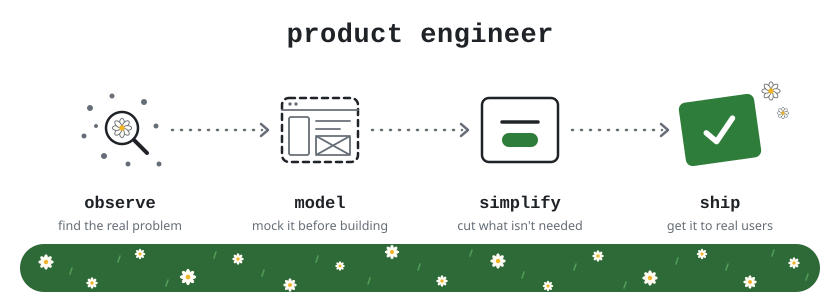
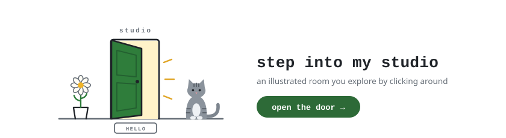
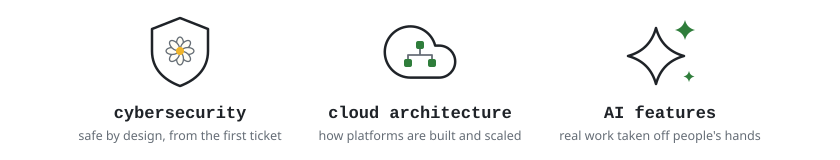

  <picture>
    <source media="(prefers-color-scheme: dark)" srcset="assets/banner-dark.svg" />
    
  </picture>

### about

I'm a product engineer at [AIP](https://github.com/aip-tech) in Cape Town. I own features end to end on a workflow platform that agency teams and their clients rely on every day: I find the real problem, design the answer, build it across the front end and the API, and see it through release.

### portfolio

  <a href="https://vintusoul.github.io/portfolio/">
    <picture>
      <source media="(prefers-color-scheme: dark)" srcset="assets/portfolio-dark.svg" />
      
    </picture>
  </a>

### what I do

- Full stack in TypeScript, from React interfaces to a GraphQL API.
- Loose requests turned into scoped problems before any code is written.
- Mocks before builds, so decisions happen on a canvas instead of in code review.
- Fast on real data, with every payload sized for the largest accounts.
- Writing for the people who use the product, from interface copy to release notes.

### day to day

  
  
  
  
  
  
  
  

### working towards

  <picture>
    <source media="(prefers-color-scheme: dark)" srcset="assets/towards-dark.svg" />
    
  </picture>

